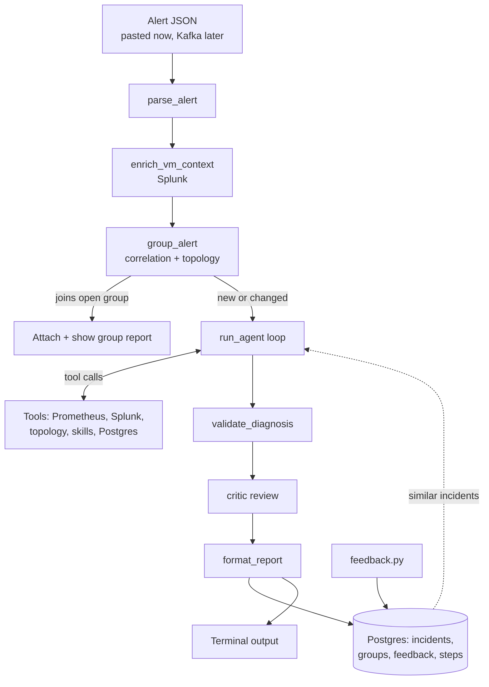

# DESIGN: VMDown Triage Agent

SPEC.md says **what** the agent does and **why**. PLAN.md says **in what order** to build it. This file says **how it is put together**: components, data contracts, flows and the decisions behind them. When code and this file disagree, fix one of them.

Related: `SPEC.md`, `PLAN.md`, `SECURITY.md`, `EVALUATION.md`, `VM_DOWN_REFERENCE.md`.

---

## 1. Architecture at a glance



Three external systems are read: **Prometheus MCP**, **Splunk MCP**, the **topology DB (read-only)**. One is written: **Postgres** (own schema). The **LLM gateway** is called for reasoning. Nothing on the cluster is changed in v1.

## 2. Principles

1. **Code owns safety, the LLM owns reasoning.** Limits, allowlists, validation and storage are plain code. The LLM only proposes the next tool or a diagnosis.
2. **Evidence or silence.** Every claim cites an evidence ID. Missing data is reported as missing, never filled in.
3. **Plain functions and dicts.** No classes. Each function does one thing, takes dicts, returns dicts.
4. **Untrusted input everywhere.** Alerts, logs, events and topology data are data, never instructions (see SECURITY.md).
5. **Degrade, don't crash.** A failed tool returns an evidence dict with `error`. A failed LLM call falls back to playbook mode.
6. **Extend by adding files.** New scenario = new skill file. New data source = new tool function. New action = new catalog entry.

## 3. Components and responsibilities

| Area | File | Responsibility | Must not |
|---|---|---|---|
| Config | `config.py` | Read env vars, fail fast on missing ones | Print secrets |
| Input | `alert_parser.py` | JSON to alert dict, validate fields | Call the LLM |
| MCP | `mcp_client.py` | Connect, list tools, call tools, timeouts and retries | Contain business logic |
| Tools | `tools_*.py` | One function per evidence tool, returns evidence dicts | Write anything, raise on query failure |
| Skills | `skills.py`, `skills/*.md` | List, load and parse skills | Execute anything |
| Classification | `skills.py` | Simple rules give a skill hint | Decide the final cause |
| Agent | `agent.py` | The loop: build prompt, call LLM, run chosen tool, enforce limits | Run tools outside the allowlist |
| LLM | `llm.py` | One call function to the gateway, JSON parse and retry | Know about tools or skills |
| Validation | `validator.py` | Check cited IDs exist and support claims | Rewrite the diagnosis |
| Critic | `critic.py` | Second LLM review of the draft | Add new evidence |
| Correlation | `topology.py`, `correlation.py` | Topology lookup, grouping, affected-vs-total | Write to the topology DB |
| Storage | `db.py` | All Postgres access | Be called from tools |
| Output | `report.py` | Format the report | Change the diagnosis |
| Entry | `main.py`, `feedback.py` | Orchestrate a run | Hold logic that belongs above |

## 4. Run flow (one alert)

1. `parse_alert`: JSON to dict. Reject with a clear message if fields are missing.
2. `enrich_vm_context`: Splunk lookup for guest OS, recent errors, launcher pod, node.
3. `get_topology` and `group_alert`: tag the alert, find an open group.
4. If it joins an open group and nothing material changed: attach, show the group's diagnosis, stop.
5. `classify_failure`: skill hint.
6. `run_agent` (or playbook mode): loop below.
7. `validate_diagnosis`, then `review_diagnosis` (critic).
8. `format_report`, print, `save_incident` with steps, evidence, hypotheses, topology snapshot.

### Agent loop

```
state = {alert, enrichment, hint, evidence: [], hypotheses: [], steps: 0}
while True:
    if limits_hit(state): break                      # code decides
    reply = call_llm(prompt(state), tools=allowed)   # LLM decides
    if reply is final_diagnosis: break
    check reply.tool is allowlisted, args valid, not a repeat
    result = run_tool_safely(reply.tool, reply.args) # never raises
    state.evidence.append(add_id(result))
    state.hypotheses = reply.hypotheses
    log_step(state)
diagnosis = finalize(state)  # validator, critic, confidence rules
```

Limits: max steps, wall-clock time, token budget, no repeated identical call, allowlisted read-only tools only. On hitting a limit the agent stops and reports with what it has.

## 5. Data contracts

**Alert (input)**
```json
{"vm_name": "", "namespace": "", "cluster": "", "severity": "", "timestamp": "ISO-8601"}
```

**Evidence item (from every tool)**
```json
{"id": "E3", "source": "prometheus|splunk|topology|postgres|local",
 "tool": "get_node_health", "query": "...", "time_range": {"from": "", "to": ""},
 "result_summary": "short text, size-capped", "data": {}, "inferred": false, "error": null}
```
Rules: `result_summary` is size-capped before reaching the LLM. `inferred: true` marks indirect signals. `error` is set instead of raising.

**Topology (from `get_topology`)**
```json
{"node": "", "storage_backend": "unknown", "network_domain": "unknown",
 "cluster": "", "datacenter": "", "source_synced_at": "ISO-8601"}
```

**Hypothesis**
```json
{"cause": "", "status": "open|supported|rejected", "evidence_ids": ["E1"]}
```

**Diagnosis (final, validated)**
```json
{"failure_type": "", "probable_cause": "", "confidence": "low|medium|high",
 "hypotheses": [], "evidence_used": ["E1"], "inferred_items": [], "missing_evidence": [],
 "next_steps": [], "do_not_do": [], "similar_incident_ids": [], "steps_taken": 0,
 "critic_notes": []}
```

**Action request (post-v1)**
```json
{"action_id": "", "params": {"cluster": "", "namespace": "", "vm_name": ""},
 "reason": "", "evidence_ids": [], "incident_id": 0}
```

## 6. Storage design

Postgres schema `vmdown_agent`: `incidents`, `incident_groups`, `feedback`, `agent_steps` (incident_id, step, tool, args, result_summary, hypotheses, timestamp), later `actions`. Raw evidence is stored as JSON on the incident with a retention policy (see SECURITY.md). The topology DB is read-only and is never written to.

## 7. Error handling policy

| Failure | Behavior |
|---|---|
| Tool query fails or times out | Evidence item with `error`; agent continues or reports a gap |
| MCP server unreachable | Retry within limits, then evidence error, report notes the gap |
| LLM returns invalid JSON | Retry once, then fall back to playbook mode |
| LLM gateway down | Fall back to playbook mode, report says so |
| Postgres down | Print the report, warn that it was not saved |
| Topology DB down | Use Prometheus labels and overrides, mark dimensions unknown |
| Limit reached | Stop, report with what exists, confidence capped at low |

## 8. Extension points

- **New failure scenario:** add `skills/<name>.md` and a line in `INDEX.md`. No code.
- **New evidence source:** add a tool function returning the evidence dict, register it in the tool list with a clear description.
- **New action (post-v1):** add a playbook in AAP and an entry in `actions.yaml`.
- **New correlation dimension:** add it to `get_topology` and `compare_scope`.

## 9. Decision log

| # | Decision | Why | Revisit when |
|---|---|---|---|
| D1 | Function-based Python, no classes | Author is new to OOP and patterns; easy to read and debug | Code grows hard to follow |
| D2 | Playbook mode built first, agent loop second | Predictable baseline to measure the agent against, and a fallback | Agent clearly outperforms and is stable |
| D3 | Bounded loop with code-enforced limits | Real agent behavior with production safety | Limits block good investigations |
| D4 | Skills as Markdown files | Add scenarios without code, easy review | Skills need structured data |
| D5 | Read-only in v1 | Wrong restarts can worsen incidents | Diagnoses proven in shadow mode |
| D6 | Read data via OTel to Splunk, not playbooks | History from before failure, no cluster credentials per query | n/a |
| D7 | Playbooks only for change-making actions, via action catalog | Governance, audit, least surprise | Direct API actions proven safer |
| D8 | Simple structured similarity, embeddings later | Debuggable, no extra infra; few incidents early | 30+ incidents with feedback |
| D9 | Topology from read-only UAT copy with `unknown` allowed | Data is partial and hours old; honesty beats guessing | A fresher authoritative source exists |
| D10 | Evidence IDs plus validator plus critic | Reduce confident but unsupported diagnoses | Metrics show the critic adds no value |
| D11 | OpenAI-compatible calls through the company gateway | Matches the available platform | Gateway changes |
| D12 | Group-once correlation | Avoid N investigations during an outage | Groups prove too coarse |

## 10. Open design questions

- Does the LLM gateway support OpenAI-style tool calling reliably, or does the loop need JSON-reply mode? (Phase 0 test.)
- Where do prompts and skills live for review: same repo or separate? (Decide in production readiness.)
- Which model(s) and what token budget per run?
- Run as a CLI, a worker service, or both in production?
